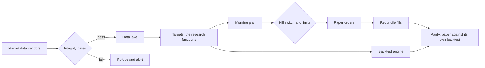

# Quant rebuild: a trading system rebuilt to catch its own mistakes

My first trading system had a backtest that looked excellent and was wrong. A date error had
taught the model the day of the week. Traded with real money for three months, it lost 3.3% while
buying and holding SPY gained 3.3%.

This is the rebuild. It is designed so that a result like that cannot pass quietly: the data is
checked before anything trades on it, the final test data is used once, every attempt is counted,
and paper trading is compared with its own backtest every day.

**Where it stands (10 November 2026):** no strategy has beaten buying and holding SPY after
costs. Three strategies trade on paper. Nothing trades real money, and nothing will until all
three have finished testing.

This repository is a showcase. The code is private; what is here is how the system works, what
the research found and what went wrong along the way. The first attempt, with a correction at
the top, is at [quant-trading-pipeline](https://github.com/andsalazar/quant-trading-pipeline).

## Why it was rebuilt

A review of the first system found four errors behind its results:

| Error | What it did |
|---|---|
| **Dates stamped one day early** | One weekday's label was "down" every time. The model learned the weekday, which alone gave an out-of-sample AUC of 0.63 to 0.66. On unaffected rows AUC was 0.49 to 0.52: chance |
| **The backtest's trade was not the live trade** | The label ran close to close. Live, the data arrived a day late and the order filled at a later open |
| **Wrong instruments** | "Futures" symbols were fetched from a stock endpoint. ES was Eversource, CL was Colgate, ZS was Zscaler |
| **No held-back data** | About twenty experiments were compared on the same history, with no correction for the number of attempts |

None of these is exotic. Each one is a check that was missing.

## The rules the rebuild runs on

1. **One code path.** Research, paper and live call the same functions for features, targets and
   fills. Every deploy re-derives the daily paper targets from the research definitions on the
   server's own data and refuses to go ahead if they differ.
2. **The exchange calendar is the truth.** Every daily index is the NYSE session calendar.
   Timestamps are UTC inside and converted only at the edges.
3. **The label is the trade.** A backtest fills at the time the live order will fill, including
   the delay before the data is available.
4. **Data checks gate everything.** The calendar must match exactly, prices must match a
   reference vendor, the instrument's asset class is verified, and leakage canaries run in CI
   (shuffled labels must score chance; an injected future value must score perfectly).
5. **A locked holdout, used once.** The most recent year was kept out of every choice and then
   evaluated a single time. A guard in the database refuses a second run.
6. **Every trial is counted.** Each configuration tried goes into a ledger, and results are
   reported with the Deflated Sharpe Ratio, which discounts for the number of attempts.
7. **Baselines first.** Every candidate is compared with buy and hold and with a simple trend
   strategy, after costs.
8. **Paper before money.** At least 20 sessions in which paper trading matches its own backtest,
   then a human decision. Trade decisions are deterministic code; no model or agent places a
   live order.

## How it runs

- **Evening:** prices and index membership are ingested. A dataset that fails a check is not
  published, and jobs that depend on it refuse to trade.
- **Morning:** a plan is built and stored before the open, then executed in two waves around it.
  The kill switch, order limits, a daily-loss breaker and available cash are checked before
  every single order.
- **After the close:** fills are reconciled, and the day's paper equity is compared with a
  backtest replayed from the targets the system recorded.
- **Three ways a failure reaches me:** the job pushes an alert itself; the server pushes one if
  the job died without managing to; and a separate check outside the server reports any job that
  did not run or did not finish.

## What the research found

**The locked holdout** (2025-10-01 to 2026-10-20, 265 sessions, after costs), evaluated once
against rules written down beforehand:

| Strategy | Return | Excess Sharpe | Max drawdown | Result |
|---|---|---|---|---|
| SPY buy and hold (the bar) | 16.3% | 0.90 | −8.9% | — |
| Volatility-managed SPY | 14.6% | 0.80 | −8.9% | Confirmed as drawdown control. Did not beat SPY |
| 8-ETF trend with a volatility target | 7.5% | 0.59 | −5.2% | Confirmed, as a reference only |
| 70/30 SPY and gold | 14.0% | 0.68 | −11.2% | Not confirmed: the diversifier caused the drawdown |

**Since then:**

- There are 23 experiment scripts and 50 rows in the trial ledger. **No candidate has passed.**
- The intraday idea is the clearest negative. The configuration now on paper earned 0.29 basis
  points a day before costs, against a hurdle of 5.7 to 8.1, and lost 3.2 a day after costs.
- For that experiment, with 45 trials counted, a result needed an annualised Sharpe ratio of
  about 2.6 to count as evidence. So every new experiment now starts with a power check: if it
  could not clear its bar even when its own hypothesis is true, it is not run without a written
  override.

## Paper trading

Three strategies have traded on paper since 22 October 2026:

| Strategy | Standing |
|---|---|
| Volatility-managed SPY | Passed its holdout rule as drawdown control |
| Two-weekly reversal in S&P 500 stocks | Failed its development rule; kept as a forward test only |
| Intraday sector reversal | No configuration passed; runs for education, with no performance claim |

What paper trading is testing is mostly the pipeline. On 9 November the three paper books were
within 7 basis points of their replayed backtests, against a limit of 50.

## Things that went wrong, and what changed

- **A delisted stock froze the stock data.** A company was acquired and stopped trading. The
  coverage check counted its missing prices as a hole and refused to publish, so one strategy
  did not trade for four sessions. The refusal was correct and safe. Nobody noticed, because
  the failure looked the same as a routine alert. The check now measures a delisted stock to
  its last session, and the alerting was rebuilt so that a real failure cannot look routine.
- **A missed rebalance stayed missed.** The failure above fell on a scheduled rebalance. It was
  not made up late, because a late trade is one the backtest never makes. The sessions are
  marked in the record as off-strategy instead.
- **Rounding that would have stopped trading.** Target weights were stored rounded to six
  decimals. Sixty-five equal weights rounded that way sum to 1.000025, which the engine refuses.
  A review caught it two weeks before a basket of that size could have been recorded.
- **A circuit breaker that could not trip.** If the broker reported no opening equity, the
  daily-loss check read the loss as zero. It now blocks new buys when it cannot measure.
- **A deploy that could install an unchecked build.** The deploy now builds under a separate
  tag, runs the self-check in that build, and switches only if it passes.

## Built with a team of AI agents

The system is written by a small team of AI agents with fixed roles, directed by me and working
to the rules above.

- A **lead** plans the work and writes the hypothesis down before an experiment runs.
- **Engineers** for research, data, execution, the dashboard and operations do the building.
- A **reviewer** that cannot edit anything reads every change before it is merged. It is asked
  for a concrete failure, not an opinion, and it rejects changes regularly. The rounding error
  above was one of its findings.
- **A guard the agents cannot switch off on their own** blocks any command that touches the real
  account, its credentials or its kill switch. Anything that touches real money is run by me.

Every decision is a short written record: 38 so far, each with what was measured and what was
not verified. The test suite has about 1,200 tests, the core is type-checked in strict mode, and
the deploy script refuses a commit whose checks have not passed.

## Stack

Python (`uv`, `ruff`, `mypy`, `pytest`) · Parquet files for the data lake · Postgres on
Supabase as the system of record · Docker and systemd timers on a single server · a read-only
Next.js dashboard on Vercel · Alpaca for paper trading and market data · Tiingo and FRED for
reference data · restic for off-site backups · GitHub Actions for CI and the outside heartbeat.

## What is not here

- The code, the data and anything about the account.
- A strategy that works. None has been found, and this page will say so for as long as that is
  true.

Nothing here is financial advice.
